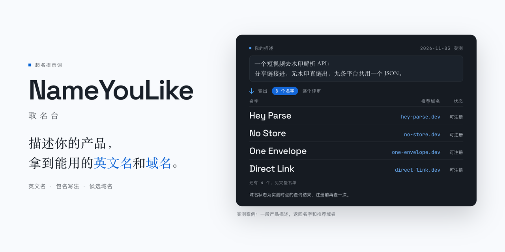

<div align="center">



# NameYouLike · 取名台

**描述你的产品，拿到 8 个能用的英文名和推荐域名。**

[][effect]
[][quick-start]
[](https://www.python.org)
[](LICENSE)

[在线使用](https://itcox.cn/NameYouLike/) · [快速开始][quick-start] · [实际效果][effect] · [域名核验][domain-check] · [项目结构][structure] · [边界][limits]

</div>

NameYouLike 是一段起名提示词。把 `prompt.txt` 整段发给任意 AI agent，它会按你的产品描述默认给你 8 个英文名，能当 npm 包名、GitHub 仓库名或产品名用。每个名字配 2 到 3 个候选域名，交付前会查域名、npm 包名、GitHub 用户名和同名仓库、商标，撞了就换。

> [!NOTE]
> 只做英文名。域名查到的是当时有没有被注册，保留词和溢价词可能还要另外买。

项目的目标和验收标准见 [`user-input.md`](user-input.md)。

## 快速开始

打开 [提示词页面](https://itcox.cn/NameYouLike/)，点「复制」，把整段提示词发给能联网的 AI agent。也可以直接打开 [`prompt.txt`](https://raw.githubusercontent.com/hey-yx/NameYouLike/main/prompt.txt) 复制。

产品描述还是占位符。直接发也行，agent 会先问你要产品描述。想一次跑完，先把 `{{产品描述}}` 换成你的产品，再发。

它会先查同名项目和同类产品，再起名、逐名评审，补足 8 个，最后给名单和域名。

想在本地改页面，再跑（需要 Node.js 和 pnpm）：

```bash
pnpm install
pnpm dev      # 打开 http://localhost:5173/NameYouLike/
```

改动后可以跑测试和构建：

```bash
pnpm test     # 85 个单元测试，不联网
pnpm build    # 生成静态页面到 web/dist
```

## 实际效果

输入是一段产品描述。下面是 2026-11-03 的一次实测，产品是短视频去水印解析 API：

> allparse 是一个短视频去水印解析 API：给一条分享链接，返回无水印视频或图集直链；九条短视频平台统一输出同一种 JSON 信封。

返回 8 个名字，这里列出其中 3 个：

| 名字 | 包名 | 推荐域名 | 当时状态 |
|---|---|---|---|
| Hey Parse | `hey-parse` | `hey-parse.dev` | 可注册 |
| No Store | `no-store` | `no-store.dev` | 可注册 |
| Direct Link | `direct-link` | `direct-link.dev` | 可注册 |

状态是当时查的，现在可能变了。完整名单和评审结论在 `research/prompt-run/`，页面上也展示整份结果。

名字要跟产品有关，看到名字能猜到产品做什么。支持全拼、首字母、破折号写法，比如 `guizang-ppt-skill`。域名优先 `.dev`、`.io`、`.app`。

## 域名核验

提示词要求 agent 交付前把域名查完。仓库里也带了查询脚本，可以单独跑：

```bash
python3 scripts/domain-check-fast.py --variants hey-parse,no-store --json out.json
```

脚本直接查域名注册局，不经过第三方查询站。返回可注册、已注册、保留这些状态，查不清的写未确认，溢价会单独标出。

> [!WARNING]
> 查询结果会变。看到「可注册」也请在注册商页面再确认一次。

## 项目结构

```
prompt.txt     起名提示词正文，拿走即用
web/           提示词页面：展示、复制、实测案例
lib/           页面数据和命名检查规则
scripts/       域名查询脚本与案例校验
research/      实测记录与命名资料
python/        本地备选名生成器与命名数据
tests/         单元测试
```

`python/` 下有两个本地工具，不调模型：一个按种子词生成候选名和域名形式，一个整理公开的命名案例。需要 Python 3.10+，命令见 `python/README.md`。

## 边界

- 可用不等于可注册：保留词、溢价词要去注册商页面确认。
- 商标要去官方商标库查（USPTO、CNIPA）：提示词会让 agent 先查，公开库查不到时会写明查过哪里。
- 不做中文名，域名也只查拉丁字母写法，不支持带中文或其他文字的域名。
- 页面只展示提示词，不在线生成名字，也没有账号和付费功能。
- 不代注册、不代付款。

[quick-start]: #快速开始
[effect]: #实际效果
[domain-check]: #域名核验
[structure]: #项目结构
[limits]: #边界
